# fea-structural-py

> Finite Element Analysis in Python: 2D and 3D truss, beam, frame and plate solvers with stress and deflection plots, buckling and vibration checks, and validation against analytical results.

A small, readable FEA toolkit written with **NumPy and SciPy only**. Every solver is checked against closed-form results, and every number and plot below is produced by the notebook or by `make_figures.py` in this repo.

This is a **flat project**: all files are in the repo root, with no sub-folders.

## What is inside

| Solver | Element | Used for |
|---|---|---|
| `Truss2D` | 2-node bar | Bridges, frames, member forces |
| `Truss3D` | 3D bar element | Space trusses, towers, tripods |
| `Beam` | Euler-Bernoulli (Hermite cubic) | Deflection, shear and moment diagrams, vibration modes |
| `Frame2D` | Beam-column, 3 dofs per node | Portal frames, rigid joints, member end forces |
| `PlaneStressQ4` | 4-node quadrilateral (plane stress or plane strain) | Plates, stress concentration, von Mises stress, principal stresses, safety factor |

## Workflow

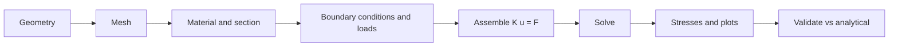

## Quick start

```bash
pip install -r requirements.txt
python test_fea.py                 # 19 validation tests
streamlit run app.py               # optional interactive dashboard
jupyter notebook FEA_Structural_Analysis.ipynb
```

```python
import numpy as np
from fea_core import Beam

beam = Beam(np.linspace(0, 2.0, 5), E=210e9, I=8e-6)      # cantilever, 2 m
beam.solve(fixed=[0, 1], point_loads={4: -1000.0})       # 1 kN down at the tip
print(beam.u[8])                                          # tip deflection in metres
```

## Results (computed by the notebook)

### Validation against analytical solutions

| Case | FEM | Exact | Error |
|---|---|---|---|
| Cantilever, tip load | 1.58730 mm | 1.58730 mm | < 1e-10 % |
| Cantilever, UDL | 1.19048 mm | 1.19048 mm | < 1e-10 % |
| Simply supported, central load | 0.09921 mm | 0.09921 mm | < 1e-10 % |
| Simply supported, UDL | 0.12401 mm | 0.12401 mm | < 1e-10 % |
| Fixed-fixed, UDL | 0.02480 mm | 0.02480 mm | < 1e-10 % |
| Triangle truss (method of joints) | 3333.33 / -6009.25 N | 3333.33 / -6009.25 N | < 1e-10 % |
| Plate patch test (uniform tension) | 100 MPa, 0.952381 mm | 100 MPa, 0.952381 mm | exact |

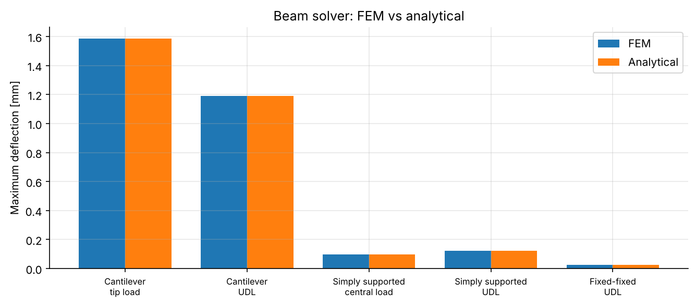

### Beam: deflection, shear and moment

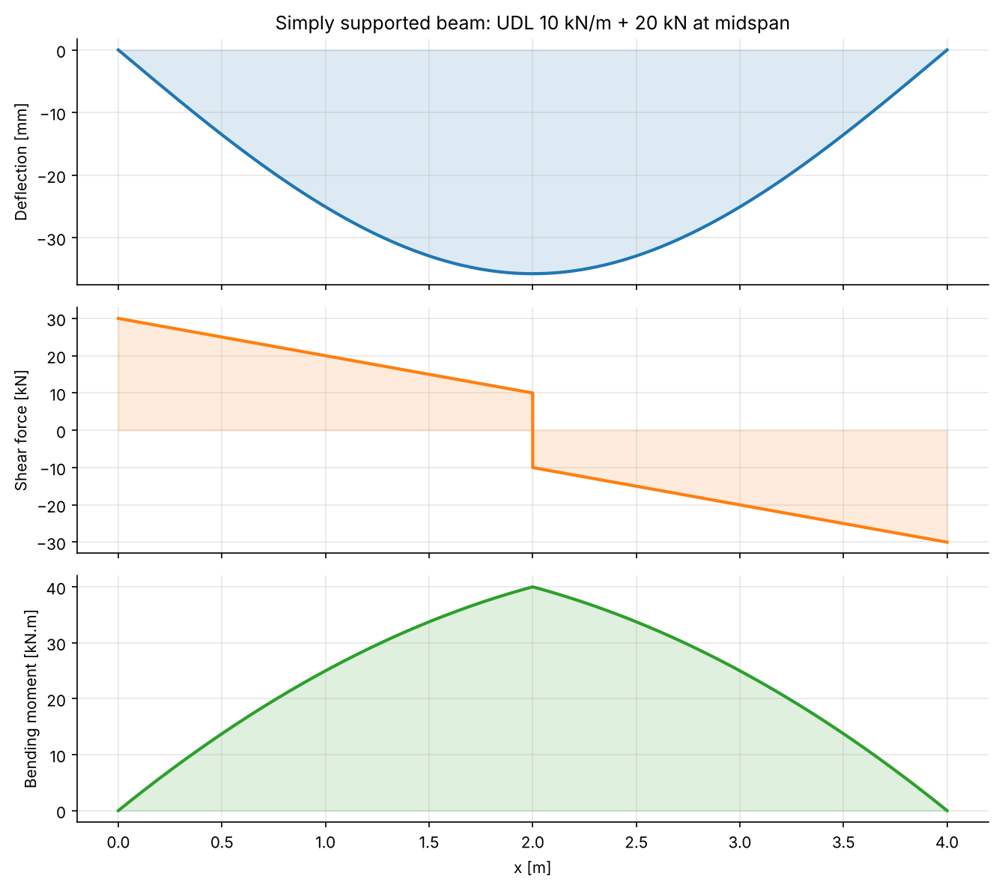

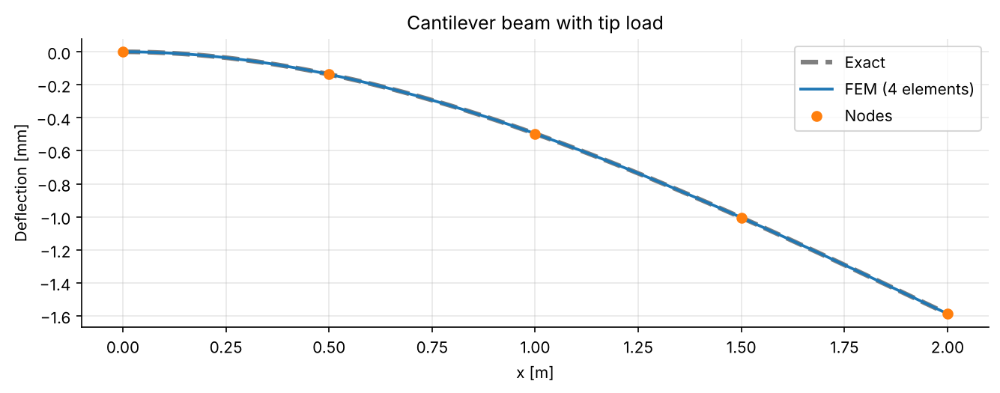

### Warren truss

20 kN at each interior bottom node, steel members of 20 cm². Largest axial force 48.00 kN (compression), largest stress 24.0 MPa, largest displacement 2.09 mm.

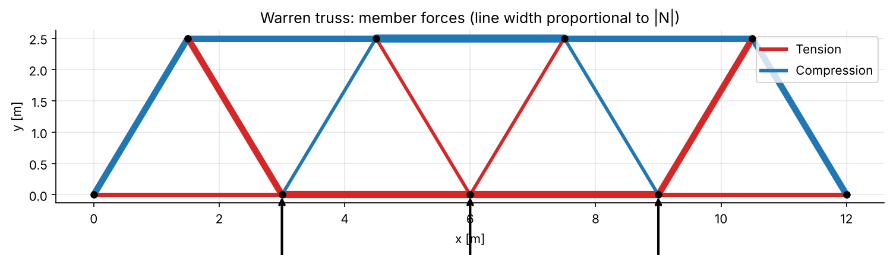

### Plate with a circular hole

Hole radius 50 mm in a 1 m square plate, nominal stress 50 MPa. FEM gives Kt = 3.09, compared with 3.00 (Kirsch, infinite plate) and 3.02 (handbook, finite width). The small gap comes from the square plate geometry.

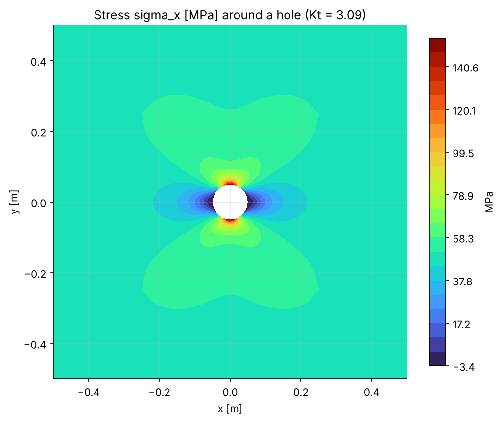

### Mesh convergence

| DOF | Kt |
|---|---|
| 126 | 3.0363 |
| 374 | 3.0778 |
| 1122 | 3.0870 |
| 2450 | 3.0869 |
| 4290 | 3.0866 |
| 9506 | 3.0864 |

The standard Q4 element shows **shear locking** on coarse meshes of slender bending problems: a 5x1 mesh of a cantilever plate gives only 67 % of the Timoshenko tip deflection. Switching on incompatible modes (`PlaneStressQ4(..., incompatible=True)`) lifts that to 98.5 % on the same 24-dof mesh.

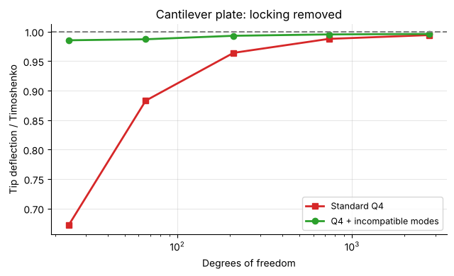

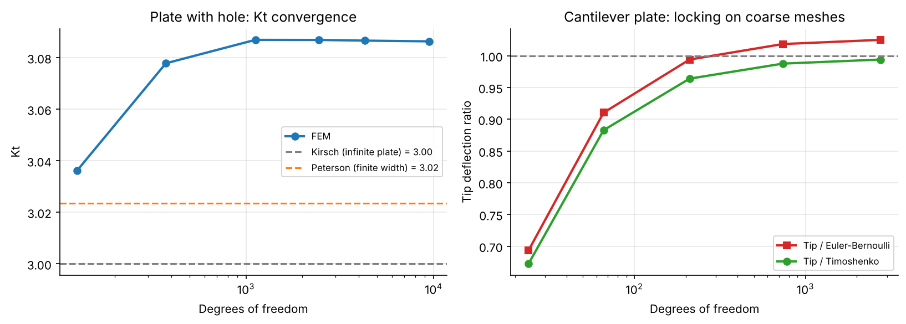

### Von Mises stress and safety factor (plate with hole, 50 MPa nominal)

Maximum von Mises stress is 153.3 MPa.

| Material | Yield | Safety factor | Max nominal stress |
|---|---|---|---|
| Steel (structural) | 250 MPa | 1.63 | 81.5 MPa |
| Aluminium 6061-T6 | 276 MPa | 1.80 | 90.0 MPa |
| Titanium Ti-6Al-4V | 880 MPa | 5.74 | 287.0 MPa |

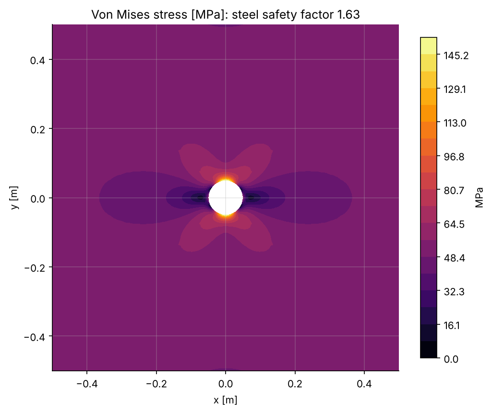

### Portal frame (Frame2D)

Steel portal frame, 4 m span, 3 m high, fixed bases, 10 kN lateral load and 5 kN/m on the beam. Sway at the loaded joint is 0.841 mm and the reactions balance the loads to round-off.

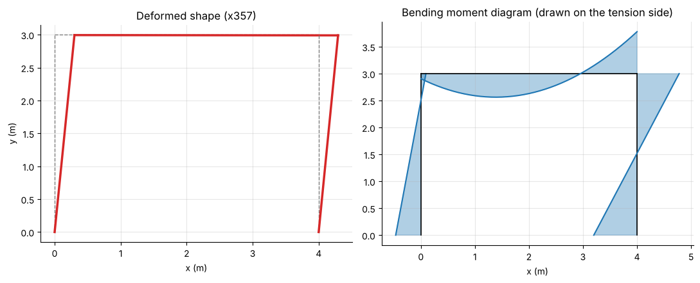

### Portal frame vibration

First three frequencies of the same frame (16 elements per member, steel): 29.34, 84.53 and 190.80 Hz. The first frequency changes by less than 0.01 % between 8 and 16 elements per member.

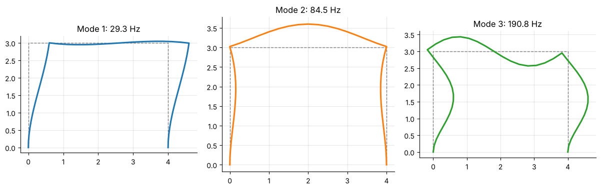

### 3D space truss

Steel tower, 2 m x 2 m base, 1 m x 1 m top, 3 m high, 12 members, with 10 kN lateral and 20 kN downward load on one top node. Largest force 15.41 kN (compression), reactions balance the loads to round-off.

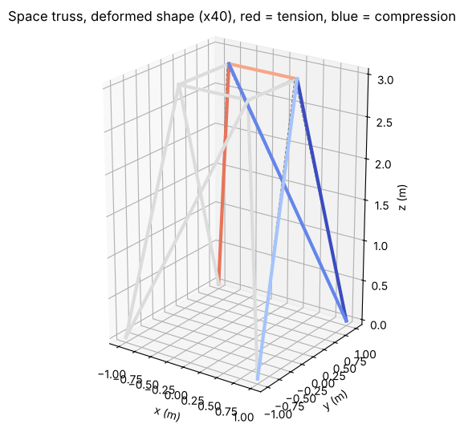

### Material comparison (40 mm square cantilever, 1 m, 1 kN tip load)

| Material | Tip deflection | Mass | E/rho | Safety factor |
|---|---|---|---|---|
| Steel (structural) | 7.440 mm | 12.56 kg | 26.75 MJ/kg | 2.67 |
| Aluminium 6061-T6 | 22.678 mm | 4.32 kg | 25.52 MJ/kg | 2.94 |
| Titanium Ti-6Al-4V | 13.730 mm | 7.09 kg | 25.69 MJ/kg | 9.39 |

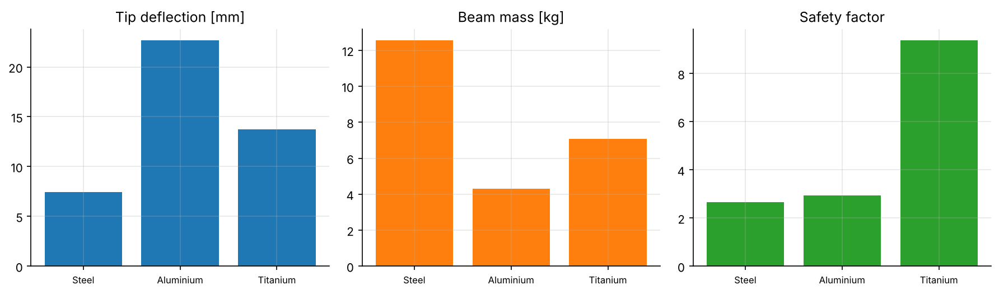

### Vibration modes of the cantilever beam

| Mode | FEM | Exact | Error |
|---|---|---|---|
| 1 | 33.421 Hz | 33.421 Hz | 0.0004 % |
| 2 | 209.444 Hz | 209.445 Hz | 0.0002 % |
| 3 | 586.458 Hz | 586.455 Hz | 0.0006 % |
| 4 | 1149.277 Hz | 1149.196 Hz | 0.0070 % |

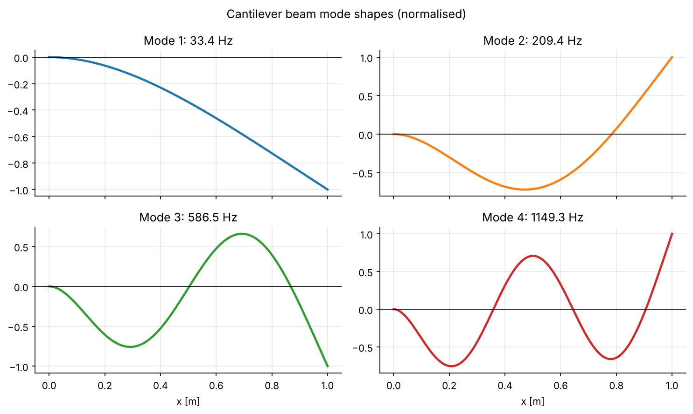

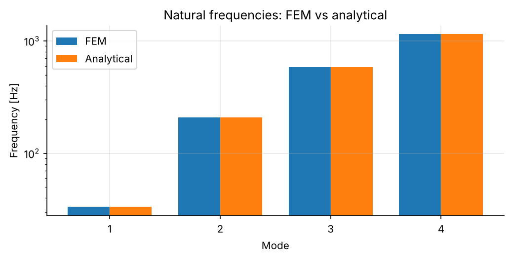

## Charts and comparison tables

Run `python make_figures.py` to regenerate every chart and table below (it also writes `comparison_tables.md`).

### 2D charts

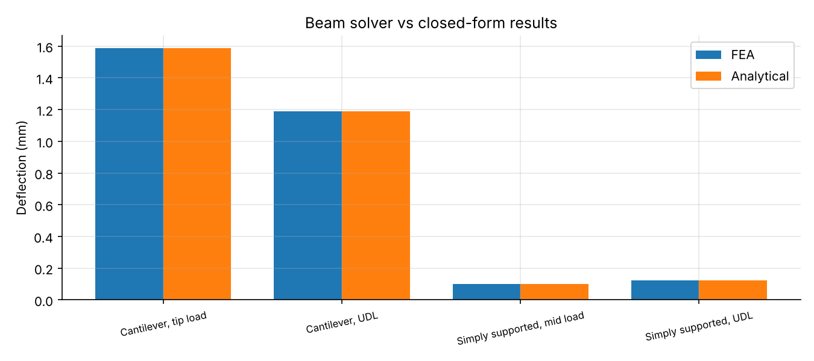

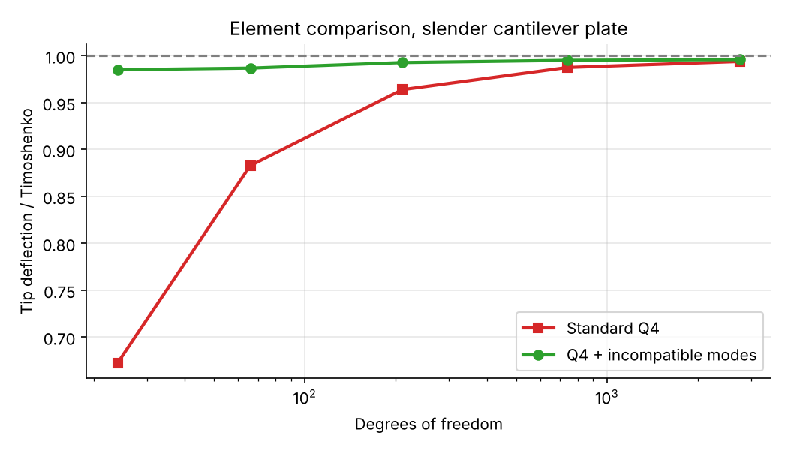

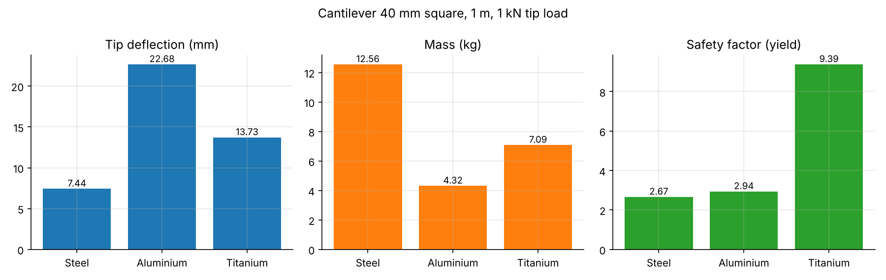

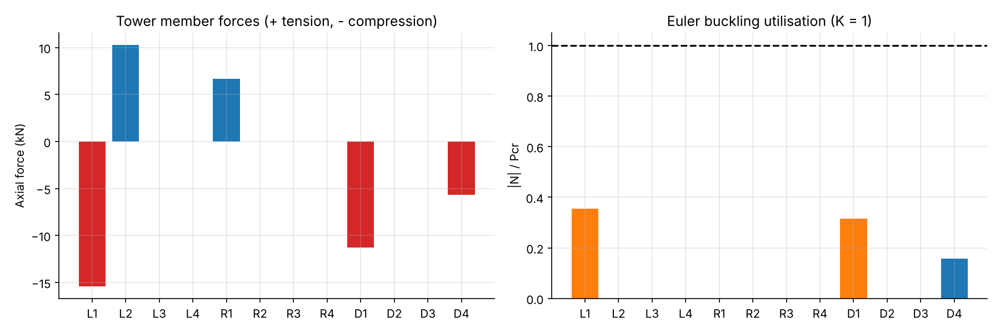

### 3D charts

Von Mises stress over the full plate with a hole (quarter model mirrored), shown as a 3D surface and a contour map:

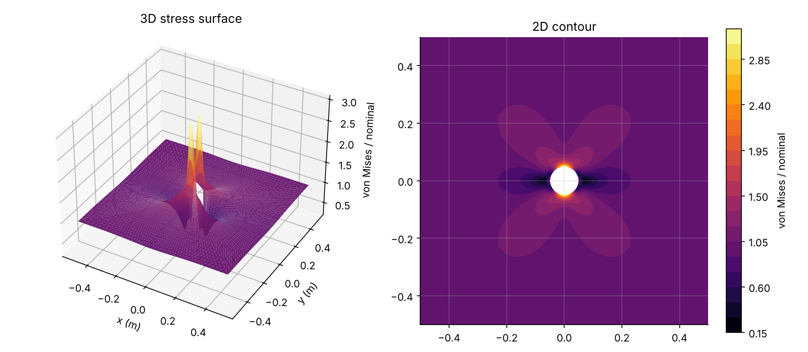

Design map: tip deflection of a steel cantilever as a function of length and section height, from the `Beam` solver:

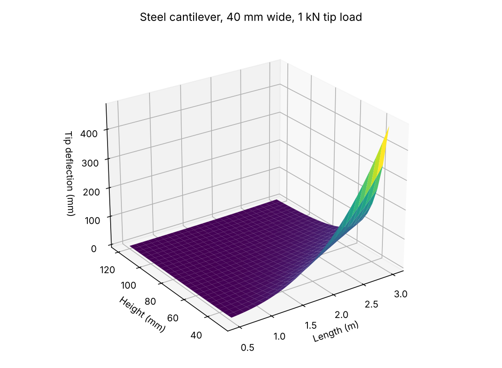

### Comparison tables

#### Beam solver vs analytical (E = 210 GPa, I = 8e-6 m4, L = 2 m, 1 kN or 1 kN/m)

| Case | FEA (mm) | Analytical (mm) | Relative error |
|---|---|---|---|
| Cantilever, tip load | 1.58730 | 1.58730 | 1.4e-16 |
| Cantilever, UDL | 1.19048 | 1.19048 | 0.0e+00 |
| Simply supported, mid load | 0.09921 | 0.09921 | 9.6e-16 |
| Simply supported, UDL | 0.12401 | 0.12401 | 8.7e-16 |

#### Q4 element comparison (cantilever plate, tip deflection / Timoshenko)

| Mesh | DOFs | Standard Q4 | Q4 + incompatible modes |
|---|---|---|---|
| 5x1 | 24 | 0.6724 | 0.9853 |
| 10x2 | 66 | 0.8829 | 0.9870 |
| 20x4 | 210 | 0.9640 | 0.9929 |
| 40x8 | 738 | 0.9877 | 0.9952 |
| 80x16 | 2754 | 0.9941 | 0.9960 |

#### Material comparison (40 mm square cantilever, 1 m, 1 kN)

| Material | E (GPa) | Tip deflection (mm) | Mass (kg) | Stiffness / mass | Safety factor |
|---|---|---|---|---|---|
| Steel (structural) | 210.0 | 7.440 | 12.56 | 10701 | 2.67 |
| Aluminium 6061-T6 | 68.9 | 22.678 | 4.32 | 10207 | 2.94 |
| Titanium Ti-6Al-4V | 113.8 | 13.730 | 7.09 | 10275 | 9.39 |

#### 3D tower: member forces and Euler buckling (tube OD 50 mm, A = 8.0 cm2, K = 1)

| Member | Length (m) | Force (kN) | Pcr (kN) | Utilisation |
|---|---|---|---|---|
| L1 | 3.082 | -15.41 | 43.4 | 0.35 |
| L2 | 3.082 | 10.27 | 43.4 | 0.00 |
| L3 | 3.082 | 0.00 | 43.4 | 0.00 |
| L4 | 3.082 | 0.00 | 43.4 | 0.00 |
| R1 | 1.000 | 6.67 | 412.6 | 0.00 |
| R2 | 1.000 | 0.00 | 412.6 | 0.00 |
| R3 | 1.000 | 0.00 | 412.6 | 0.00 |
| R4 | 1.000 | 0.00 | 412.6 | 0.00 |
| D1 | 3.391 | -11.30 | 35.9 | 0.32 |
| D2 | 3.391 | 0.00 | 35.9 | 0.00 |
| D3 | 3.391 | 0.00 | 35.9 | 0.00 |
| D4 | 3.391 | -5.65 | 35.9 | 0.16 |

#### Solver overview

| Class | Element | DOF per node | Static | Modal | Notes |
|---|---|---|---|---|---|
| Truss2D | 2-node bar | 2 | yes | no | Member forces, reactions |
| Truss3D | 2-node bar | 3 | yes | no | Space trusses, use with euler_buckling |
| Beam | Hermite cubic | 2 | yes | yes | Shear and moment diagrams |
| Frame2D | Beam-column | 3 | yes | yes | Rigid joints, member UDL, end forces |
| PlaneStressQ4 | 4-node quad | 2 | yes | no | Plane stress or strain, optional incompatible modes |

#### Plate with hole (nominal 50 MPa)

| Quantity | Value |
|---|---|
| Kt (Q4 + incompatible modes, 24x48) | 3.105 |
| Kirsch (infinite plate) | 3.000 |
| Peak von Mises / nominal | 3.030 |
| Safety factor vs yield (steel, 250 MPa) | 1.65 |

## 3D diagrams

These are illustrative concept diagrams. Any numbers drawn inside them (loads, spans, element counts, error values) are examples, not outputs of this code. The computed results are in the notebook and in the sections above.

| | |
|---|---|
| 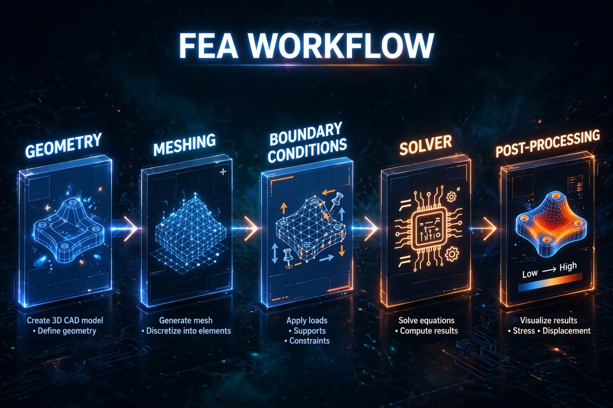 | 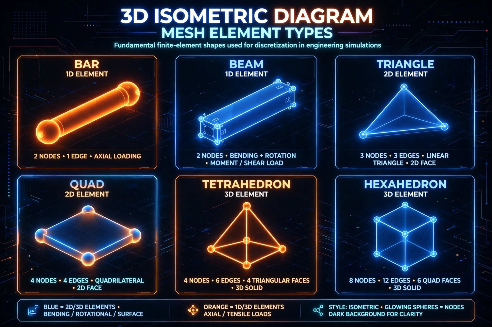 |
| 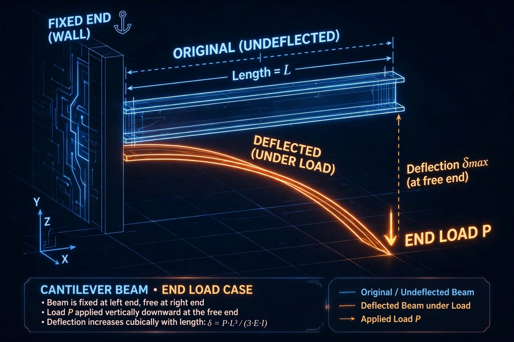 | 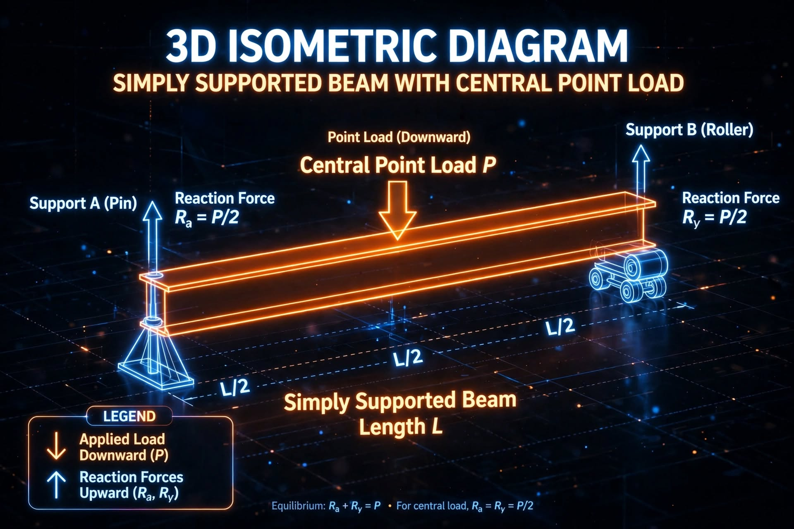 |
| 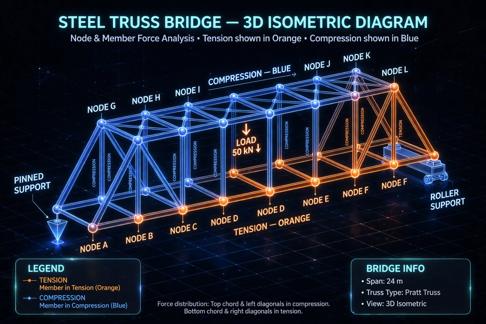 | 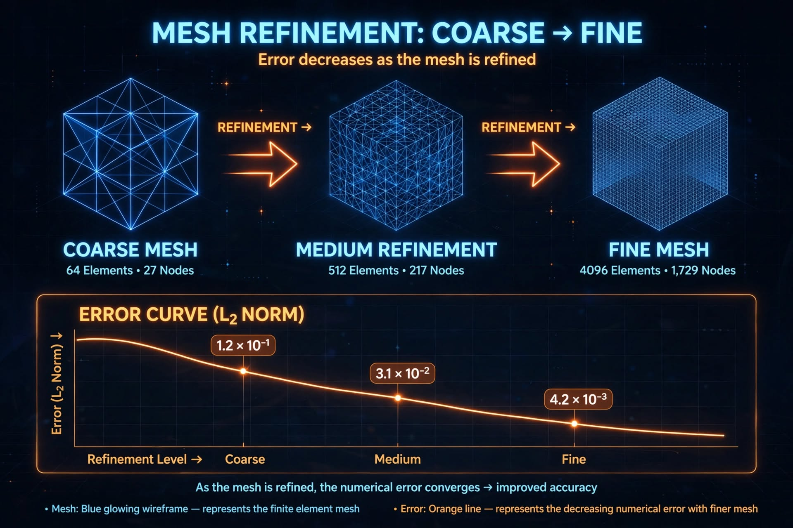 |
| 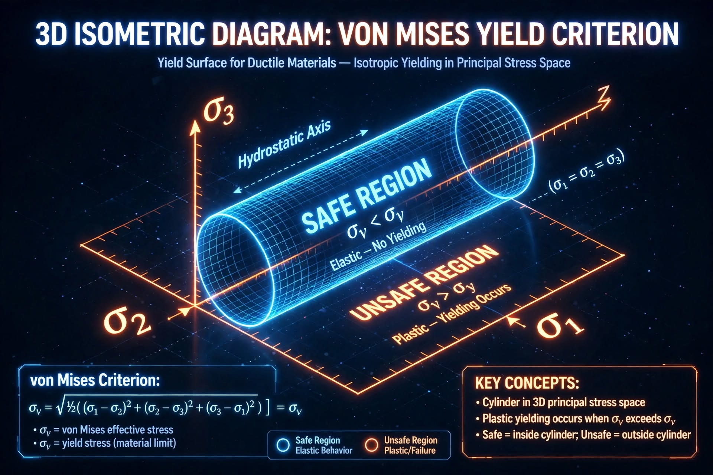 | 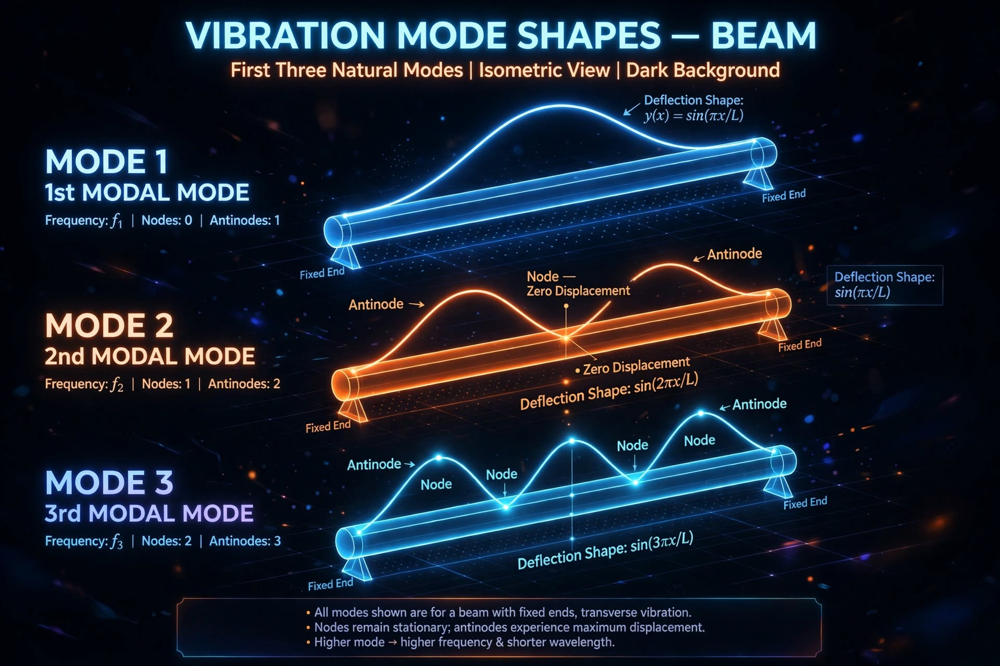 |
| 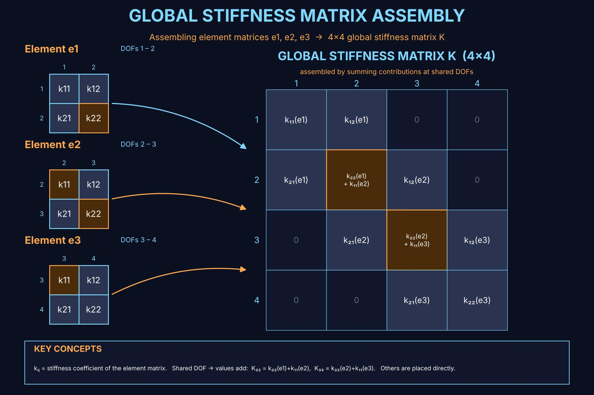 | 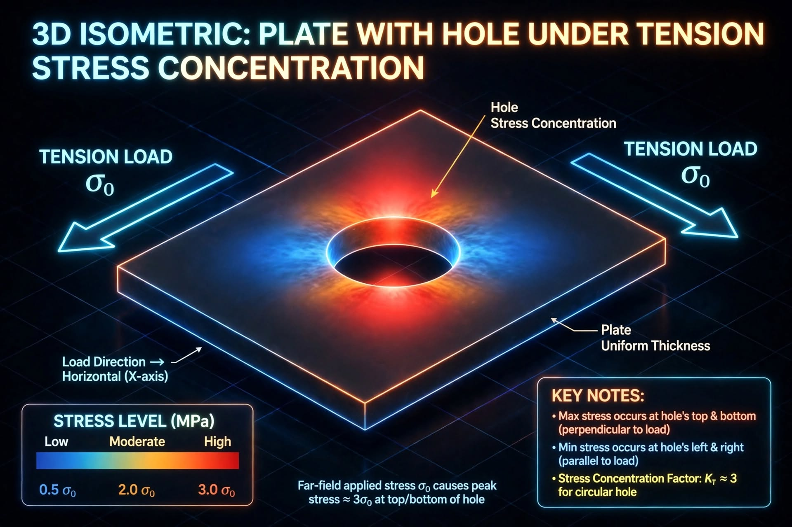 |

## Files

| File | Purpose |
|---|---|
| `fea_core.py` | All solvers and mesh helpers |
| `FEA_Structural_Analysis.ipynb` | Full tutorial notebook with outputs |
| `test_fea.py` | 19 validation tests |
| `make_figures.py`, `comparison_tables.md` | Chart and comparison-table generator and its output |
| `app.py` | Streamlit dashboard: beam, plate with hole, portal frame |
| `fig_*.png` | Plots generated by the notebook |
| `3d_*.jpg` | 3D concept diagrams |
| `requirements.txt`, `LICENSE` | Dependencies and MIT license |

## New in v1.2

- `euler_buckling(N, L, E, I, K)`: Euler buckling check for compression members (works with `Truss2D` and `Truss3D` results). Tested against the pinned-column closed form.
- `make_figures.py`: generates the 2D and 3D charts and comparison tables.

## New in v1.1

- `PlaneStressQ4(..., incompatible=True)`: Wilson-Taylor incompatible modes that remove shear locking, with condensed internal dofs and matching stress recovery. Passes the patch test on a distorted mesh.
- `Frame2D.modal`: natural frequencies and mode shapes with a consistent mass matrix. Checked against the cantilever bending and axial closed forms and against rotation invariance.
- `Truss3D`: space truss with member forces, stresses and reactions. Checked on a tripod (closed form) and against `Truss2D` for a planar case.
- `Frame2D`: rigid-jointed 2D frames with nodal loads, member UDL (fixed-end forces) and member end forces. Checked against cantilever, axial and fixed-fixed beam closed forms plus force equilibrium.
- `PlaneStressQ4(..., plane="strain")`, `von_mises(s, nu=...)`, `principal(s)` and `safety_factor(vm, sy)`.
- Notebook section 10: portal frame (static and modal) with `fig_frame.png` and `fig_frame_modes.png`. Section 11: 3D tower with `fig_truss3d.png`. Section 6: locking fix with `fig_locking_fix.png`.
- `app.py`: Streamlit dashboard (needs `pip install streamlit`).
- Corrected stiffness-assembly diagram (`3d_stiffness_matrix_assembly.jpg`), drawn with Matplotlib.

```python
from fea_core import Frame2D
fr = Frame2D([[0, 0], [0, 3], [4, 3], [4, 0]], [[0, 1], [1, 2], [3, 2]], E=210e9, A=8e-3, I=1e-4)
res = fr.solve(fixed=[(0, 0), (0, 1), (0, 2), (3, 0), (3, 1), (3, 2)], nodal_loads={1: (10e3, 0, 0)})
print(res["u"][1, 0])   # sway of the top-left joint in metres
```

## Limitations

Linear elasticity, small deformations, static and free-vibration analysis only. Material values are typical handbook figures. This is a learning and prototyping tool, not a certified design check.

## License

MIT, see `LICENSE`.
